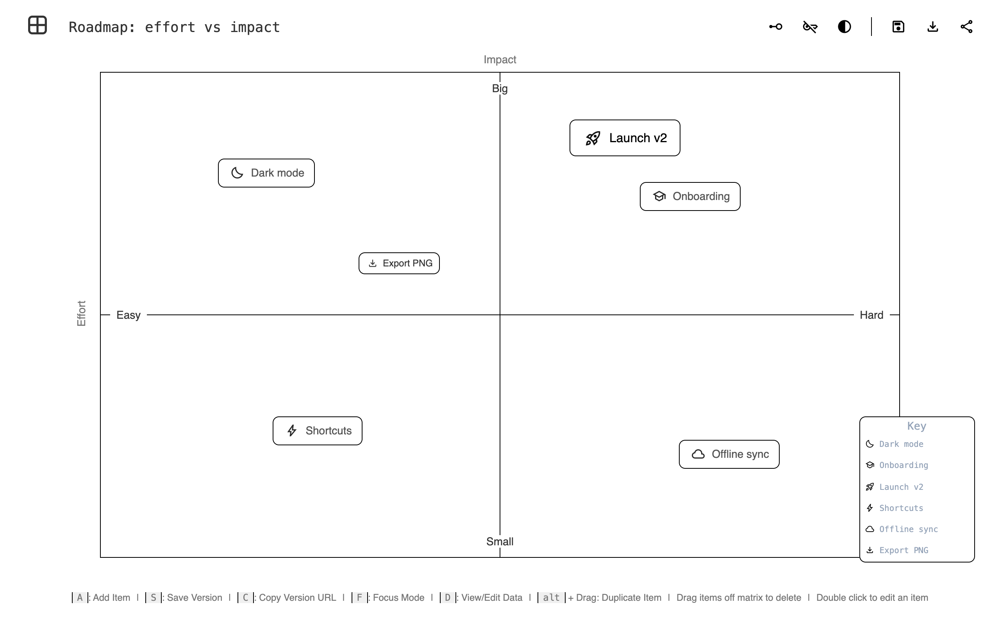
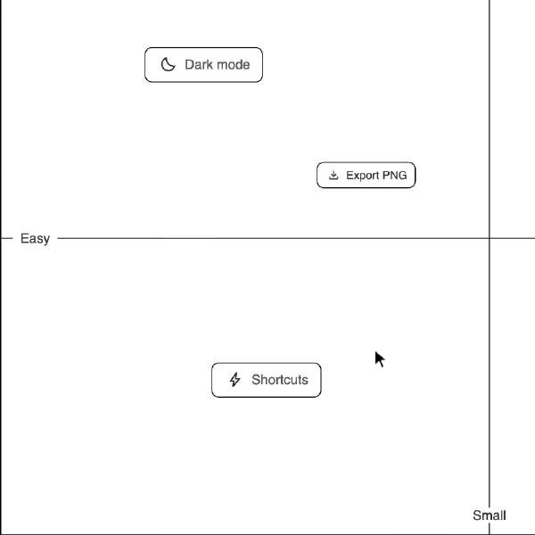
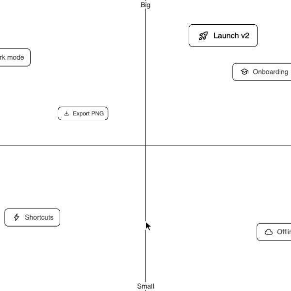
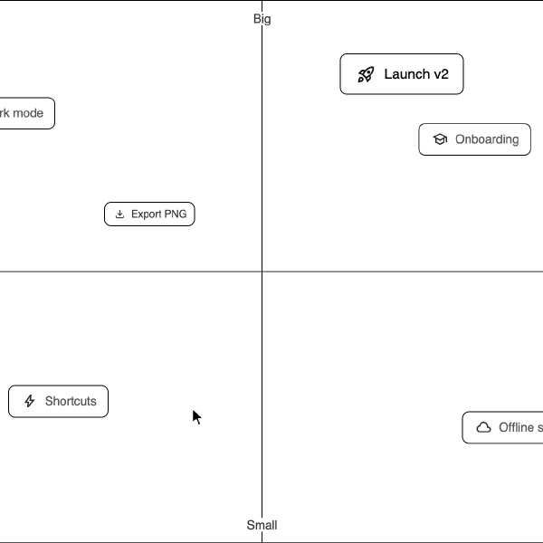
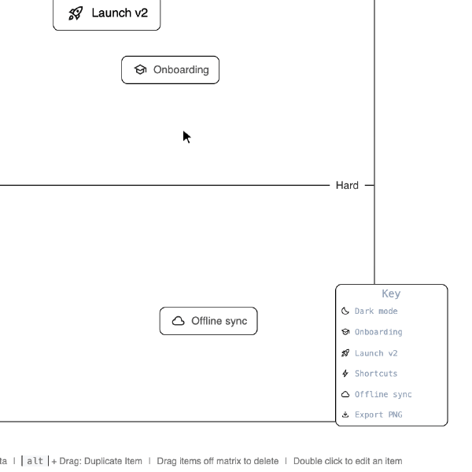
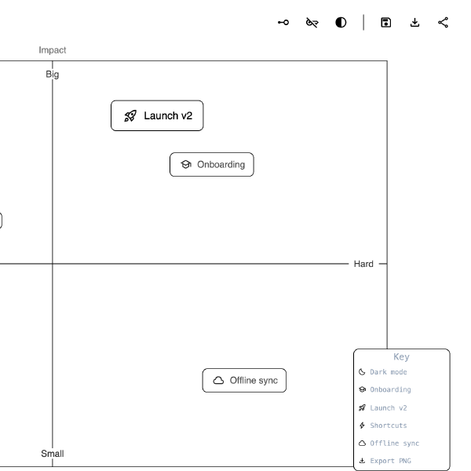

# `quadrant`

A quick 2×2 matrix for sorting ideas. Drag items into quadrants, label the axes, and share the result as a link.

  
[<kbd> haaans.com/quadrant  </kbd>](https://haaans.com/quadrant/?data=eyJ0aXRsZSI6IlJvYWRtYXA6IGVmZm9ydCB2cyBpbXBhY3QiLCJsYWJlbHMiOnsieS1heGlzLWxhYmVsIjoiSW1wYWN0IiwieC1heGlzLWxhYmVsIjoiRWZmb3J0IiwieS1oaWdoIjoiQmlnIiwieS1sb3ciOiJTbWFsbCIsIngtbG93IjoiRWFzeSIsIngtaGlnaCI6IkhhcmQifSwiaXRlbXMiOlt7InRleHQiOiJEYXJrIG1vZGUiLCJpY29uIjoiYmVkdGltZSIsImNvbG9yIjoiIzExMTExMSIsInNpemUiOiJtZCIsInBvc2l0aW9uIjp7ImxlZnQiOiIxNTBweCIsInRvcCI6IjExMHB4In19LHsidGV4dCI6Ik9uYm9hcmRpbmciLCJpY29uIjoic2Nob29sIiwiY29sb3IiOiIjMTExMTExIiwic2l6ZSI6Im1kIiwicG9zaXRpb24iOnsibGVmdCI6IjY5MHB4IiwidG9wIjoiMTQwcHgifX0seyJ0ZXh0IjoiTGF1bmNoIHYyIiwiaWNvbiI6InJvY2tldF9sYXVuY2giLCJjb2xvciI6IiMxMTExMTEiLCJzaXplIjoibGciLCJwb3NpdGlvbiI6eyJsZWZ0IjoiNjAwcHgiLCJ0b3AiOiI2MHB4In19LHsidGV4dCI6IlNob3J0Y3V0cyIsImljb24iOiJib2x0IiwiY29sb3IiOiIjMTExMTExIiwic2l6ZSI6Im1kIiwicG9zaXRpb24iOnsibGVmdCI6IjIyMHB4IiwidG9wIjoiNDQwcHgifX0seyJ0ZXh0IjoiT2ZmbGluZSBzeW5jIiwiaWNvbiI6ImNsb3VkIiwiY29sb3IiOiIjMTExMTExIiwic2l6ZSI6Im1kIiwicG9zaXRpb24iOnsibGVmdCI6Ijc0MHB4IiwidG9wIjoiNDcwcHgifX0seyJ0ZXh0IjoiRXhwb3J0IFBORyIsImljb24iOiJkb3dubG9hZCIsImNvbG9yIjoiIzExMTExMSIsInNpemUiOiJzbSIsInBvc2l0aW9uIjp7ImxlZnQiOiIzMzBweCIsInRvcCI6IjIzMHB4In19XSwia2V5SXRlbXMiOltdfQ%3D%3D)

## Features

<table>
<tr valign="top">
<td width="50%">
<h3>Drag items into place</h3>

Grab any item and drop it where it belongs. The matrix is free-form, so where an item sits is the whole point.

</td>
<td width="50%">

</td>
</tr>
<tr valign="top">
<td width="50%">

</td>
<td width="50%">
<h3>Press A, then name it</h3>

Press A to drop a new item onto the matrix, then double-click it to rename it.

</td>
</tr>
<tr valign="top">
<td width="50%">
<h3>Restyle from the icon</h3>

Click an item's icon to pick a size, a color, or one of over a hundred Material icons.

</td>
<td width="50%">

</td>
</tr>
<tr valign="top">
<td width="50%">

</td>
<td width="50%">
<h3>Duplicate or delete by dragging</h3>

Hold Alt and drag to copy an item. Drag one off the matrix to delete it.

</td>
</tr>
<tr valign="top">
<td width="50%">
<h3>Save versions, share a link</h3>

Press S or click save to keep a version in your history. Share copies a link with the whole matrix in the URL, with no account or database.

</td>
<td width="50%">

</td>
</tr>
</table>
